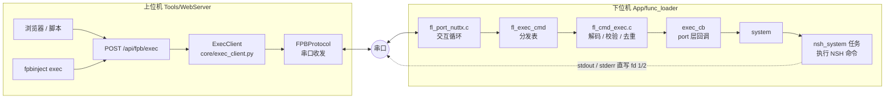
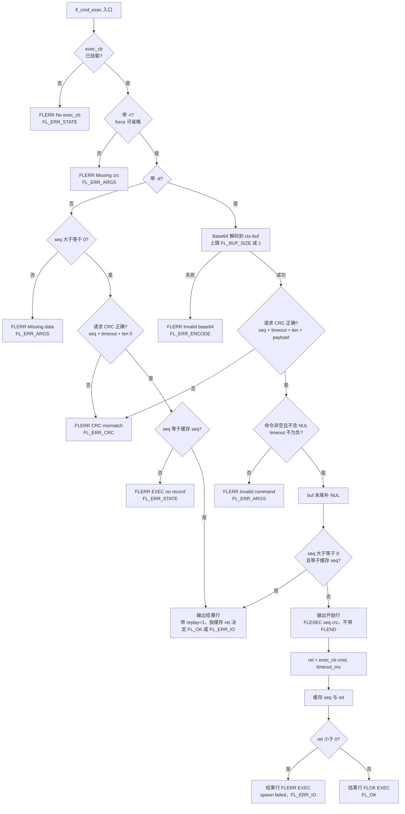
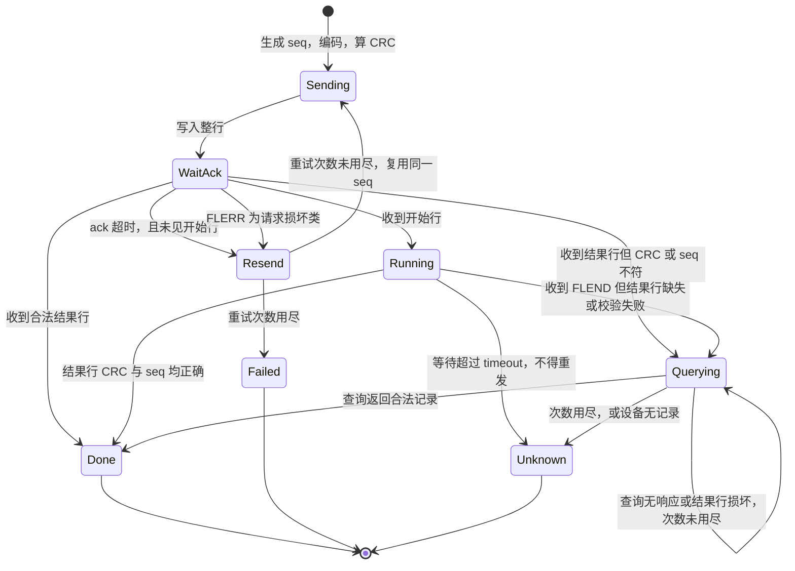
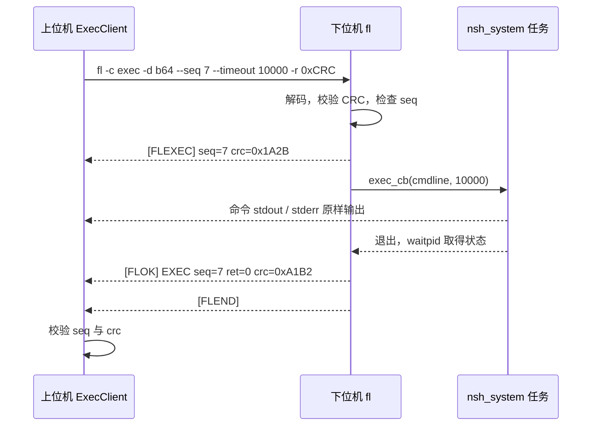
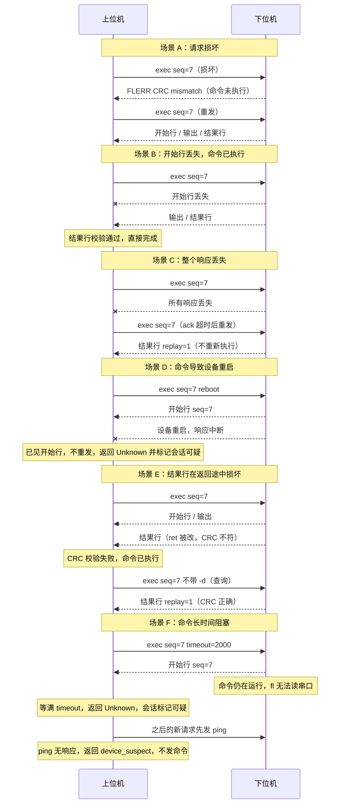

# exec 命令设计方案：经 fl 协议可靠执行 NSH 命令

| 项目 | 内容 |
|------|------|
| 状态 | 已实现，第 7 版 |
| 范围 | 下位机 `App/func_loader`、上位机 `Tools/WebServer`（core / app / cli） |
| 目标平台 | NuttX（通过 `system()` 对接 NSH） |
| 相关文档 | `file-transfer-design.md`、`crc-integrity-audit-v2.md`、`security-token-design.md`、`tx-fragment-auto-adapt-design.md` |

版本变化：

- 第 2 版：去掉 `FL_USE_EXEC` 编译开关；请求 CRC 覆盖 `seq`；结果行带 CRC；新增只读“查询”模式。
- 第 3 版：回调接口加入 `timeout_ms`；开始行带 CRC；上位机增加“会话可疑”状态。
- 第 4 版：
  - **去掉设备端超时终止（kill）**。NuttX 的 `kill` 是否可靠还没有结论，现阶段阻塞命令靠用户自觉，NuttX port 直接用 `system()`。
  - `timeout` 参数保留在接口和协议里并透传到回调，但 v1 的 NuttX port **不处理**它。
  - 开始标记保持单行 `[FLEXEC] seq=N crc=0x....`，**后面不跟 `[FLEND]`**，整个 exec 只有一个 `[FLEND]`，由结果行收尾。（评审中曾考虑让开始行也单独成帧，因为收益小于成本，已放弃。）
  - 因为没有设备端终止，上位机的会话可疑机制保留，并在文案上明确提示“命令可能仍在运行”。
  - 新增 6.9：SDK（`fpbinject.Client.exec_cmd`）的接口、模式支持、错误约定；HTTP 响应增加 `error_code` 和 `output_truncated`。

- 第 5 版（实现落地后同步）：
  - **重试次数复用 `transfer_max_retries`**。exec 不再有自己的默认值：调用方不给 `max_retries` 时取设备连接上的 `transfer_max_retries`（与文件传输是同一个配置项、同一个 `--transfer-max-retries` 命令行参数），范围 0 到 20。与文件传输的区别是：exec 只在“确认设备还没开始执行”时才重发整条请求，见 6.3。
  - **NuttX port 失败时返回 `-errno`**（取不到时用 `-EIO`），而不是固定的 `-EIO`。上位机的提示里带上 `errno N on the device`。注意这是设备（NuttX）的 errno 编号，不一定与上位机操作系统的编号一致，所以只显示数字，不翻译成名字。
  - HTTP 客户端超时统一用 `worst_case_seconds(timeout, ack_timeout, max_retries)`，覆盖存活探测、全部重发、命令等待和结果恢复查询；服务器的 worker 窗口也用同一个函数。
  - 新增错误码 `device_error`（设备以非“请求损坏”类原因拒绝了请求，例如 `Invalid command`）。

- 第 6 版：**删除上位机的 `exec_enabled`（Allow Exec）开关**，WebServer 不再有 exec 的开关，也没有 `exec_disabled` 错误码；设备信息弹窗增加一行 `Exec: enabled|disabled`（来自固件 `info`）。第 8 节同步修正：此前文档称 JSON 请求头能挡住网页的跨站请求，这并不成立，因为 WebServer 对所有来源开启了 CORS。

- 第 7 版：**exec 只影响发送，不影响接收**。上位机不再为 exec 另开旁路读串口、不再清空接收缓冲区，串口日志与不跑 exec 时完全一致，见 6.3.1。

## 1. 背景与目标

### 1.1 问题

直接在串口上向 NSH 敲命令存在两类问题：

1. **传输不可靠**：串口丢字符、乱码、被截断时，NSH 没有任何校验，会把损坏的命令当成合法命令执行。
2. **转义复杂**：命令里的引号、空格、`$`、`;`、`>` 等字符要同时经过 PC 端 shell、串口驱动、NSH 解析器，很难保证原样到达。

而 fl 交互模式已经具备可靠传输所需的全部要素：CRC-16 校验、`[FLEND]` 帧结束标记、上位机超时重试、按串口质量校准的单行长度预算。

### 1.2 目标

- 命令字符串用 Base64 编码后放进 fl 命令行，规避所有转义问题。
- 请求带 CRC-16，损坏的请求绝不执行。
- 返回值带 CRC-16，返回路径上的损坏可以被上位机发现并恢复。
- 具体执行动作通过**回调函数**注入，核心层不依赖 NuttX，由 port 层决定怎么执行。
- 回调接口预留 `timeout_ms` 参数，为以后的超时终止留好位置（v1 不处理）。
- 命令的 stdout / stderr 保持“敲进去就能看到”的体验，并能被上位机捕获。
- 非幂等命令（`rm`、`reboot`、`echo >> file` 等）不会因为重试被执行两次。
- 命令执行前后各有一行带 `seq` 和 CRC 的标记（开始行、结果行），明确标出开头和结尾。

### 1.3 非目标（v1 不做）

- 不做交互式会话（命令读取 stdin、`top` 一类持续刷新的程序）。
- 不做超过单行长度预算的长命令分片传输。长脚本走“文件传输 + 执行脚本”的路径。
- 不做命令输出（stdout / stderr）的 CRC 保护（见 7.5）。
- **不做超时终止，也不做主动取消。** 命令一旦启动，只能等它自己结束。
- 不做阻塞命令的设备端保护，由用户自行避免执行会长时间阻塞的命令。

## 2. 现状与约束

以下均来自当前代码，是方案的硬约束。

| 约束 | 出处 | 对方案的影响 |
|------|------|--------------|
| 命令经 `fgets` 读入，缓冲区 `FL_NUTTX_LINE_SIZE`，默认 1024 | `fl_port_nuttx.c` | 单行最长约 1022 字符，超长会被截断，剩余部分被当成下一行 |
| 传输缓冲 `ctx->buf` 为 `FL_BUF_SIZE`（1024）字节 | `fl.h` | Base64 解码目标；需要给结尾 NUL 留 1 字节 |
| 响应以 `[FLOK]` / `[FLERR]` 开头，`[FLEND]` 结尾 | `fl_log.c` | exec 沿用该帧格式 |
| 现有标记只有 `[FLOK]`、`[FLERR]`、`[FLEND]`、`[FLEXIT]` | `fl_log.c`、`fl_port_nuttx.c` | `[FLEXEC]` 是新增的第五个，风格与 `[FLEXIT]` 一致 |
| `fl_response` 内部 `log_buf` 仅 256 字节且全局共享 | `fl_log.c` | 回调内不能再调用 `fl_print*` |
| `fl_exec_cmd` 返回非 `FL_OK` 时，交互循环会打印 `fl_error` | `fl_port_nuttx.c` | “命令执行了但返回非 0”不能映射成 fl 错误码 |
| 上位机 `send_cmd` 超时后会**自动重发**整条命令，且每次重试前会清空输入缓冲 | `serial_protocol.py` | 重发对非幂等命令有风险，所以 exec 必须用独立的收发循环 |
| 上位机单行长度由 `upload_chunk_size` 校准间接约束 | `serial_protocol.py: write_memory` | exec 需沿用同一套预算算法 |
| `serial_protocol.py` 已 1435 行，限制 1500 行 | `Tools/check_file_lines.py` | 上位机新增代码必须放新模块 |
| 文件传输已有事务锁（`begin_transaction` / `file_transaction`，冲突抛 `TransferBusy`） | `core/file_txn.py` | exec 需要与它互斥，具体复用方式实现时核对 |

### 2.1 NuttX 侧 `system()` 的行为（已读源码）

- `apps/system/system/system.c`：`system()` 通过 `task_spawn("system", nsh_system, ...)` 启动独立任务，再 `waitpid(pid, &rc, 0)` **无限期**等待，返回 `rc`。
- `apps/nshlib/nsh_console.c: nsh_newconsole()`：新会话的输入、输出、错误流分别为 `STDIN_FILENO`、`STDOUT_FILENO`、`STDERR_FILENO`，读写直接走 `read` / `write`。
- `nuttx/sched/group/group_setuptaskfiles.c`：新任务通过 `fdlist_copy` 继承父任务的文件描述符表。

结论：命令的 stdout / stderr 不会被吞，会和在 NSH 里敲命令一样直接出现在串口上。`system()` 本身没有超时能力，命令不返回，fl 就一直停在 `waitpid`。

## 3. 总体架构



分层原则：

- **核心层**（`fl_cmd_exec.c`）只负责协议：解码、校验、去重、帧输出。它只认识 `exec_cb` 这个函数指针。
- **port 层**（`fl_port_nuttx.c`）负责“怎么执行”：NuttX 上就是调用 `system()`。其他平台（裸机、Linux 主机测试）可以挂各自的实现，或者不挂。
- **上位机** `ExecClient` 负责可靠性策略：重发判定、两阶段等待、结果校验与查询、输出切分、会话可疑状态。

## 4. 线协议

### 4.1 CRC 约定

三类报文各带一个 CRC-16，算法与现有命令相同（`fl_crc16_base`，初值 `0xFFFF`），整数一律按**小端序**参与计算。

| 方向 | 报文 | 覆盖范围 | 作用 |
|------|------|----------|------|
| 请求 | 整条 exec 命令 | `seq`（int32）+ `timeout`（uint32，毫秒）+ `len`（uint32）+ 命令字节 | 命令、长度、请求 ID、超时任一损坏都会被拒绝 |
| 开始行 | `[FLEXEC] seq=N crc=` | `seq`（int32） | 上位机核对这是本次请求的开始行 |
| 结果行 | `[FLOK/FLERR] EXEC seq=N ret=R crc=` | `seq`（int32）+ `ret`（int32） | 返回值、请求 ID 任一损坏都会被上位机发现 |

请求 CRC 把 `seq` 一并纳入，是因为 `seq` 决定了去重行为：如果 `seq` 在途中被改成了和缓存相同的值，一条全新的命令会被当成“重发”而不执行。

请求 CRC 把 `timeout` 一并纳入，是因为它会原样交给回调。虽然 v1 的 NuttX port 不处理它，但一旦以后有 port 去执行超时终止，一个被改坏的值（`5000` 变成 `50`，或变成 `0`）就会造成误杀或失控，所以从协议层就保证它不会在途中损坏。

### 4.2 请求

执行命令：

```
fl -c exec -d <base64(cmdline)> --seq <id> --timeout <ms> -r 0x<crc16>
```

查询已执行命令的结果（不带 `-d`，绝不会执行任何东西）：

```
fl -c exec --seq <id> -r 0x<crc16>
```

| 参数 | 类型 | 必需 | 说明 |
|------|------|------|------|
| `-c exec` | 字符串 | 是 | 命令名 |
| `-d` | Base64 | 执行时必需 | 命令行文本（UTF-8，不含 NUL）。省略且 `seq >= 0` 即为查询 |
| `--seq` | 整数 | 否 | 请求 ID，范围 0 到 2^31-1，缺省 -1 表示不去重。上位机总是携带 |
| `--timeout` | 整数 | 否 | 毫秒，缺省 0。**原样透传给 `exec_cb`，v1 的 NuttX port 不处理**。负数被拒绝 |
| `-r` | CRC-16 | 是 | 见 4.1。查询时 `len` 取 0，`timeout` 取解析到的值（上位机不带，即 0） |
| `--force` | 布尔 | 否 | 仅供手工调试，允许省略 `-r` |

CRC 在 exec 上**强制要求**，与 `write` 等“可选 CRC”的命令不同：执行一条被篡改的命令，后果远比写入一段被篡改的数据严重。

Base64 字符集（`A-Z a-z 0-9 + / =`）不含空格和引号，不会触发 `fl_stream_parse_line` 的分词与引号处理，也不会被 argparse 误认为选项，这正是它能绕开转义问题的原因。

“省略 `-d` 就是查询”这个设计的安全方向是对的：即使手滑漏掉 `-d`，结果也只是一次不会产生副作用的查询。

### 4.3 响应：开始行、输出、结果行

一次成功启动的 exec 是**一个帧**，帧内依次是开始行、命令输出、结果行，最后以 `[FLEND]` 收尾：

- **开始行**：`[FLEXEC] seq=N crc=0x....`，单独一行，**后面不跟 `[FLEND]`**。在回调被调用**之前**输出，表示“请求已被设备接受，命令即将开始”。
- **命令输出**：命令自己的 stdout / stderr，原样透传。
- **结果行**：`[FLOK]` 或 `[FLERR]` 开头，带返回值，后面跟 `[FLEND]`。在回调返回**之后**输出。

```
[FLEXEC] seq=7 crc=0x1A2B
<命令自己的 stdout / stderr，原样透传>
[FLOK] EXEC seq=7 ret=0 crc=0xA1B2
[FLEND]
```

开头由 `[FLEXEC]` 行标出，结尾由 `[FLEND]` 标出，两端都带 `seq`（开头带 CRC，结尾的结果行带 CRC）。整个 exec 只有一个 `[FLEND]`，帧结构与现有命令一致：`[FLEND]` 紧跟在 `[FLOK]` 或 `[FLERR]` 行之后，现有的 `parse_response` 之类的工具也能认出它。

去重命中或查询命中（命令不会再执行一次，**没有开始行**，输出无法重放，只有结果行）：

```
[FLOK] EXEC seq=7 ret=0 crc=0xA1B2 replay=1
[FLEND]
```

命令没能启动（回调返回负值）：

```
[FLEXEC] seq=7 crc=0x1A2B
[FLERR] EXEC seq=7 ret=-5 crc=0x3C4D spawn failed
[FLEND]
```

查询时设备没有该 `seq` 的记录（例如设备重启过）：

```
[FLERR] EXEC seq=7 no record
[FLEND]
```

请求本身被拒绝（此时命令一定没有执行，也没有开始行）：

```
[FLERR] CRC mismatch: 0x1234 != 0x5678
[FLEND]
```

结果行格式固定为 `EXEC seq=<n> ret=<n> crc=0x<XXXX>`，字段顺序固定，便于上位机用一条正则严格匹配。`replay=1` 和失败原因文字放在 `crc=` 之后，不参与校验，它们损坏最多影响提示信息，不影响 `ret` 的可信度。

设备端用 `fl_print` 输出开始行（`fl_response` 固定带 `[FLOK]` / `[FLERR]` 前缀且自带 `[FLEND]`，不适用），写法与 `echoback`、`read` 这类自行拼装输出的命令一致。

### 4.4 开始行的校验与处理原则

上位机对开始行分三种情况处理：

| 情况 | 处理 |
|------|------|
| 格式正确，`seq` 等于本次请求，CRC 正确 | 确认命令已开始，之后不再重发整条命令 |
| 格式正确，CRC 正确，但 `seq` 不是本次请求 | 上一次请求的残留，忽略 |
| 出现 `[FLEXEC]` 前缀，但格式或 CRC 不对，或者这一行还没收完整（缺换行） | 无法确认 `seq`，**保守地按“已开始”处理**，不再重发整条命令 |

第三种按“已开始”处理，是因为“误以为没开始而重发”可能造成命令重复执行，代价大于“误以为已开始而放弃重发”，后者最坏只是返回 `Unknown`。

### 4.5 字段与错误码

| 场景 | 响应 | fl 返回码 | 上位机处理 |
|------|------|-----------|------------|
| 命令执行完毕，退出码任意 | 开始行 + `[FLOK] EXEC ... ret=N crc=` | `FL_OK` | 校验 CRC 与 seq 后完成 |
| 回调返回负值（启动失败） | 开始行 + `[FLERR] EXEC ... spawn failed` | `FL_ERR_IO` | 校验后失败，不重发 |
| 查询命中 | `[FLOK] EXEC ... replay=1` | `FL_OK` | 完成，标记输出丢失 |
| 查询无记录 | `[FLERR] EXEC ... no record` | `FL_ERR_STATE` | 返回 `Unknown` |
| 未挂载 `exec_cb` | `[FLERR] No exec_cb` | `FL_ERR_STATE` | 失败，不重发 |
| 缺少 `-r`，或执行时缺 `-d` 且无 seq | `[FLERR] Missing ...` | `FL_ERR_ARGS` | 失败，不重发 |
| Base64 非法 | `[FLERR] Invalid base64 data` | `FL_ERR_ENCODE` | 请求损坏，可重发 |
| 请求 CRC 不符 | `[FLERR] CRC mismatch ...` | `FL_ERR_CRC` | 请求损坏，可重发 |
| 命令为空、含 NUL，或 `timeout` 为负 | `[FLERR] Invalid command` | `FL_ERR_ARGS` | 失败，不重发 |
| 参数解析失败 | `[FLERR] Invalid arguments` | `FL_ERR_PARSE` | 请求损坏，可重发 |

两点设计取舍：

- **“传输成功”与“命令成功”分离**。只要命令被执行了，就是 `[FLOK]`，命令的退出状态放在 `ret=` 里。否则 `ls` 找不到文件会让 `fl_exec_cmd` 返回错误，交互循环还会多打印一行 `fl_error`。
- **开始行是“已开始执行”的确认**。上位机据此判断请求已被设备接受，之后不得再重发整条命令（见第 7 节）。

## 5. 下位机设计

### 5.1 上下文与回调

`fl.h` 新增回调类型：

```c
/**
 * @brief  Execute a command line on the target platform
 * @param  timeout_ms  Requested run-time limit in milliseconds, 0 = none.
 *                     Passed through unchanged; a port MAY ignore it.
 * @return >= 0: status of the command (platform defined)
 *         <  0: the command could not be started (negative errno)
 * @note   Called synchronously from the fl task. Must not call fl_print*().
 *         A port that does not enforce timeout_ms can block indefinitely.
 */
typedef int (*fl_exec_cb_t)(void* user, const char* cmdline, uint32_t timeout_ms);
```

`fl_context_t` 新增字段，不加条件编译，仅多占十几个字节：

```c
    /* Exec callback (optional, set by port layer; NULL = exec unavailable) */
    fl_exec_cb_t exec_cb;
    void* exec_user;

    /* Last executed request, used for de-duplication and result query */
    bool exec_seq_valid;
    int32_t exec_last_seq;
    int32_t exec_last_ret;
```

命名上沿用已有的 `output_cb` / `output_user` 风格。

`timeout_ms` 是“请求的限时”，回调**可以忽略**。这样接口现在就定下来，以后某个 port 实现了可靠的终止手段，只需要改那个 port 的回调，核心层、协议、上位机都不用动。以后真要加“超时终止”的返回约定（例如专用的返回值和对应的 fl 错误码），在那一步再补，v1 不预留。

### 5.2 处理流程



实现要点：

1. 解码缓冲区最大 `FL_BUF_SIZE - 1`，解码后写入结尾 NUL，保证回调拿到合法 C 字符串。
2. NUL 检查用 `memchr(buf, 0, n)`，防止命令被“截断后只执行前半段”而与 CRC 覆盖范围不一致。
3. **先输出开始行（单行，以换行结尾，不带 `[FLEND]`），再调用回调**。输出走 `output_cb`，NuttX 实现里每次都 `fflush(stdout)`，所以开始行一定先于命令自己的输出到达串口。
4. 回调执行期间，`ctx->buf` 不得被其他路径复用。回调内也不得调用 `fl_print*`，因为 `log_buf` 是全局共享的。
5. 去重缓存只有一个槽位：只需要覆盖“紧邻的一次重发或查询”。
6. 开始行和结果行都由内部函数统一生成（先算 CRC，再输出），执行、回放、失败几条路径共用，避免格式漂移。

### 5.3 去重与查询缓存的语义

- 只缓存最近一次 `seq >= 0` 的执行结果（`seq` 与 `ret`）。
- 命中时只回放 `ret`，**不重放输出**，也不重发开始行，响应里带 `replay=1`，让上位机知道输出已丢失。
- 设备重启后缓存清空，查询返回 `no record`。这正是需要“看到开始行之后不重发整条命令”这条规则兜底的原因（见 7.3）。

### 5.4 NuttX port 层

v1 直接使用 `system()`，**不处理** `timeout_ms`：

```c
#ifdef CONFIG_SYSTEM_SYSTEM
static int nuttx_exec_cb(void* user, const char* cmdline, uint32_t timeout_ms) {
    (void)user;
    (void)timeout_ms;   /* v1: accepted but not enforced */
    int ret = system(cmdline);
    if (ret < 0) {
        /* system() returns ERROR (-1) and sets errno when it cannot spawn or
         * wait for the shell task: report -errno (fl_exec_cb_t contract). */
        return errno > 0 ? -errno : -EIO;
    }
    return ret;
}
#endif
```

在 `main()` 里 `fl_init` 之前挂载：

```c
#ifdef CONFIG_SYSTEM_SYSTEM
    ctx.exec_cb = nuttx_exec_cb;
#endif
```

用 `CONFIG_SYSTEM_SYSTEM` 做条件，是因为 `system()` 只有在该选项打开时才会被链接进来；不打开时 `exec_cb` 保持 `NULL`，exec 返回 `No exec_cb`，不会出现链接错误，也不需要额外的 FPBInject 自己的编译开关。

不实现超时终止的原因：终止任务（`kill` / `task_delete`）在 NuttX 上是否可靠还没有结论，而且强杀 `nsh_system` 任务可能留下孤儿子任务或泄漏内存。在没有验证之前，不引入一个看似有保护、实际不可靠的机制。

`system()` 同步阻塞：命令结束前，fl 主循环收不到任何新命令。**用户需要自行避免执行会长时间阻塞的命令**（读 stdin 的命令、常驻的应用等）。

### 5.5 `info` 输出与特性探测

`fl_cmd_info` 新增一行，写法与 `FileTransfer:` 一致：

```
Exec: enabled | disabled
```

`enabled` 表示 `exec_cb` 已挂载。上位机 `info()` 解析该行，UI 和 CLI 在不支持时直接给出明确提示，而不是发请求后等超时。

### 5.6 构建

没有新的编译开关。需要改动的构建文件只有两处：

| 位置 | 变更 |
|------|------|
| `App/tests/CMakeLists.txt` | 源文件清单手工列出，需加入 `fl_cmd_exec.c` |
| `Tools/build_test.sh` | 现有构建矩阵覆盖即可，无需新增配置 |

`Makefile`、`cmake/library.cmake` 都是通配符收集 `*.c`，`fl_cmd_exec.c` 会被自动编入。主机测试 / `nuttx_mock` 构建没有定义 `CONFIG_SYSTEM_SYSTEM`，port 层的 `nuttx_exec_cb` 会被整体跳过。

## 6. 上位机设计

### 6.1 模块划分

| 模块 | 职责 | 备注 |
|------|------|------|
| `core/exec_client.py`（新增） | 编码、算预算、两阶段等待、重发判定、结果校验与查询、输出切分、会话可疑状态 | 不改动 `serial_protocol.py` 的行数预算 |
| `core/serial_protocol.py` | 抽出 `_write_line()`（带分片发送的写行逻辑），供 `send_cmd` 和 `ExecClient` 共用 | 仅小幅重构 |
| `fpb_inject.py` | 暴露 `exec_cmd()` 门面 | 与 `ping()` / `info()` 同层 |
| `app/routes/fpb.py` | 新增 `POST /api/fpb/exec` | 767 行，增量很小 |
| `cli/fpb_cli.py`、`cli/server_proxy.py` | 新增 `exec` 子命令与代理方法 | 参照 `mem_write` 的写法 |
| `client.py`（SDK 门面 `fpbinject.Client`） | 新增 `exec_cmd()`，代理模式走 HTTP，直连模式进程内调用 `ExecClient` | 见 6.9 |

### 6.2 为什么不直接复用 `send_cmd`

`send_cmd` 的重试逻辑是“没收到有效标记就重发整条命令”。对 `ping`、`read` 这类幂等的命令没问题，对 exec 不行：

- 命令已经开始执行、只是耗时较长，超过了 `timeout`，`send_cmd` 会认为没响应并重发，命令被执行第二次。
- 每次重试前会 `reset_input_buffer()`，第一次执行已经输出的内容会被丢弃，同时也会吃掉与 exec 无关的日志。
- 固定的单一超时无法同时满足“尽快发现请求丢失”和“容忍命令执行很久”两种需求。
- 它不认识 exec 的开始行和结果行 CRC，也没有“查询”这条恢复路径。

所以 `ExecClient` 自己实现收发循环，只共用写行函数。

### 6.3 两阶段等待、结果校验与恢复

收发循环按行解析串口数据，直到出现 `[FLEND]` 为止：

- 出现以 `[FLEXEC]` 开头的行，就是开始行，进入阶段二。
- 开始行之后、结果行之前的文本，是命令输出。
- 以 `[FLOK]` / `[FLERR]` 开头的行是结果行，其后的 `[FLEND]` 表示整个响应结束。
- 响应里没有 `[FLEXEC]` 行、直接出现结果行的（`CRC mismatch`、`replay=1`、`no record` 等）当作终态处理。



规则：

- **阶段一（ack）**：发出后等待开始行或终态响应，时间很短（默认 1 秒，可调）。超时说明请求大概率丢了。
- **阶段二（完成）**：看到开始行后，等结果行的时间为调用方指定的 `timeout`（默认 10 秒）。设备端 v1 不会终止命令，所以这个时间只是**上位机愿意等多久**。
- **看到开始行后绝不重发整条命令。** 等满 `timeout` 仍没有结果行，返回 `Unknown`，明确告诉调用方“命令可能仍在运行，设备端没有超时终止，也可能已经结束”。开始行的三种判定见 4.4。
- **结果行必须同时通过三项校验才算有效**：格式匹配、`seq` 等于本次请求的 `seq`、`crc` 等于本地重算值。`seq` 不符的结果行视为上一次请求的残留，直接忽略。
- **结果行损坏走查询，不走重发。** 收到结果行的 `[FLEND]` 说明设备在命令结束时仍然在线，命令已经执行完了；此时发送“同 `seq`、不带 `-d`”的查询请求取回结果。查询按设计不会执行任何命令，所以即使设备缓存已丢也不会造成重复执行，最坏是 `no record`。
- 重发整条命令时**复用同一个 seq 和同一个 timeout**；每个新命令使用新的随机 seq。
- 可重发整条命令的 `[FLERR]` 仅限第 4.5 节标记为“请求损坏，可重发”的几类。

### 6.3.1 接收路径：只加发送，不动接收

exec 在发送侧新增一条命令，但接收侧保持原样：串口里的每个字节仍按原有路径进入串口日志，exec 只是“看”这些日志来解析结果，不截流、不改写、不丢弃。

| 场景 | 做法 |
|------|------|
| WebServer（命令在 `DeviceWorker` 线程里执行） | 不直接读串口。调用 `DeviceWorker.pump_rx()` 让 worker 自己的接收步骤读一轮，字节照常写入原始串口日志、串口面板、日志文件、SSE 和虚拟串口；`ExecClient` 再按日志条目 id 游标读取新增内容来解析 |
| CLI / SDK 直连（没有 worker） | 直接读串口，用增量 UTF-8 解码，按原样写日志，不做 `strip()`，避免相邻行被粘在一起 |

要点：

- 发送前不调用 `reset_input_buffer()`。发送前已在缓冲区的字节会被记入日志，而不是丢掉；解析只从发送点之后开始。
- 选择 worker 路径的条件是：设备有 worker，且当前线程正是 worker 线程。串口只允许 worker 线程读写（`ThreadCheckedSerial`），所以 exec 不能挪到别的线程，否则别的任务会抢走字节。
- exec 执行期间 worker 线程被占用，定时器、虚拟串口发送、其他 API 需要等待，这与文件下载一致。
- 存活探测 `_probe_alive` 走 `send_cmd`，仍有 `reset_input_buffer()`；它只在 exec 超时之后才会发生。

### 6.4 seq 的生成

seq 取 `secrets.randbelow(2**31)`，每个新命令一个，重发与查询时沿用。

不使用从 1 开始递增的计数器。原因：设备端缓存了上一次 seq，如果上位机进程重启后又从 1 开始，会和设备缓存里上一个会话的 seq 碰撞，导致新命令被当成“重发”而**不执行**。31 位随机数的碰撞概率可以忽略。

### 6.5 单行长度预算

沿用 `write_memory` 的算法：以已校准的 `upload_chunk_size` 推出整行预算，再扣掉 exec 的固定开销。

```
overhead = len(f"fl -c exec -d  --seq {seq} --timeout {timeout_ms} -r 0xFFFF")
budget   = b64_len(upload_chunk_size) + len("fl -c fwrite -d  -r 65535")
max_cmd  = ((budget - overhead) // 4) * 3                                    # 命令最大字节数
```

`seq` 在计算时已知，`timeout_ms` 也是，所以开销按**实际位数**计算，不需要为 `timeout` 预留最坏情况。`timeout` 不设人为上限，由协议决定的上界是 `--timeout` 为 `int`（毫秒）可表示的最大值，即 `2147483647` 毫秒，约 2147483 秒。

示例（按公式估算，非实测；取 `seq` 为 10 位、`timeout` 为默认 10 秒即 5 位数 `10000`，此时 `overhead` 为 57）：

| 场景 | 行预算 | 命令最大长度 |
|------|--------|--------------|
| 默认 `upload_chunk_size=64` | 113 | 约 42 字节 |
| 设备行缓冲 1024，上位机已校准到上限 | 约 1022 | 约 723 字节 |

`timeout` 每多一位，命令最大长度大约少 0 到 3 个字节（取整到 4 个 Base64 字符一组），影响很小。

查询请求不带 `-d` 和 `--timeout`，行很短，不受预算限制。

超出预算时 `ExecClient` 直接返回明确错误，**不静默截断**。需要执行更长的内容时，用文件传输把脚本写到设备上，再 exec 一条短命令去运行它（可用的脚本命令取决于 NSH 配置，实现时核对）。

### 6.6 HTTP API

```
POST /api/fpb/exec
Content-Type: application/json

{ "cmd": "ls -l /data", "timeout": 10.0, "ack_timeout": 1.0 }
```

| 字段 | 含义 | 默认 | 范围 |
|------|------|------|------|
| `cmd` | 命令行文本 | 无 | 受 6.5 的长度预算限制 |
| `timeout` | 上位机等待命令完成的时间（秒）；同时以毫秒作为 `--timeout` 透传给设备，**设备端 v1 不处理** | 10 | 大于 0，不设人为上限（协议上界约 2147483 秒） |
| `ack_timeout` | 等待开始行的时间（秒） | 1 | 大于 0 |
| `max_retries` | 请求损坏或丢失时重发整条命令的次数 | 设备连接的 `transfer_max_retries`（与文件传输共用） | 0 到 20 |

响应：

```json
{
  "success": true,
  "ret": 0,
  "output": "total 0\n...",
  "replayed": false,
  "started": true,
  "output_truncated": false,
  "elapsed_ms": 123.4,
  "error_code": "",
  "error": ""
}
```

`output` 有上限（默认 256 KiB）。超过上限后上位机仍会继续读串口直到响应结束（否则会遗留数据），但丢弃多出的部分并置 `output_truncated` 为 true，避免一个失控的命令（例如 `cat` 一个大文件）把 WebServer 或 SDK 调用方的内存撑满。

`success` 为 false 时，`error_code` 给出机器可读的原因，`error` 是给人看的文字：

| `error_code` | 含义 |
|--------------|------|
| `not_supported` | 设备 `info` 报告 `Exec: disabled`（未挂载 `exec_cb`） |
| `too_long` | 命令超出 6.5 的长度预算 |
| `device_suspect` | 会话处于可疑状态，且 `ping` 未通（6.8） |
| `request_failed` | 请求损坏或丢失，重发次数用尽 |
| `unknown_state` | 状态机进入 `Unknown`，无法确认命令是否已执行或仍在运行 |
| `spawn_failed` | 回调返回负值，命令没能启动 |
| `device_error` | 设备拒绝了请求，且不属于“请求损坏”类（例如 `Invalid command`），不会重发 |
| `busy` | 与文件传输等事务互斥，当前串口被占用 |

`success` 表示**传输和执行流程**是否完整，且结果行已通过 CRC 校验，不代表命令退出码为 0；命令是否成功看 `ret`。`started` 为 true 而 `success` 为 false 对应状态机的 `Unknown`，此时 `error` 里会写明“命令可能仍在运行，设备端没有超时终止”。`replayed` 为 true 表示 `ret` 来自缓存回放，`output` 可能不完整。

### 6.7 CLI

```
fpbinject exec "ls -l /data" [--timeout 10]
```

输出沿用现有 CLI 约定（`output_json`）。是否额外提供 `--raw`（直接打印 stdout 并以命令退出码结束进程）作为 v1.1 的可选项，见第 13 节。

### 6.8 会话可疑状态

当 `ExecClient` 返回 `Unknown`（等满 `timeout` 仍无结果）时，设备很可能还卡在这条命令上，或者已经重启。由于设备端没有超时终止，这种情况在 v1 里是预期会出现的。此时继续往串口里写内容是有害的：fl 不读串口，后续的请求、重发、查询都会堆积在接收缓冲里，等阻塞结束后被依次执行。

因此引入“会话可疑”标记：

1. `Unknown` 之后，`ExecClient` 把当前设备会话标记为可疑。
2. 可疑状态下，新的 exec 请求**先不发命令**，只发一条 `ping`（幂等，堆积后执行也无害），等待 `ack_timeout`。
3. `ping` 成功则清除标记，继续处理该请求；失败则直接返回 `device_suspect` 错误，不发送命令。
4. 用户可以在界面或 CLI 上显式触发一次 `ping` 来清除标记。

这条规则只约束 exec；其他命令维持现有行为。

“会话可疑”标记保存在 `FPBProtocol` 上（`exec_suspect_ser`，记录出问题时的串口对象），而不是 `ExecClient` 对象上，`FPBInject` 持有的就是这一个协议对象。这样 WebServer 路由、CLI 直连和 SDK 直连三条路径共用同一份状态；因为记录的是串口对象本身，重新连接串口（得到新的串口对象）时旧结论自动失效。存活探测用 `send_cmd("-c ping")` 并检查回复里有 `[FLOK]`，没有用 `FPBProtocol.ping()`，因为它在回复为空时也会返回成功。

### 6.9 SDK（`fpbinject.Client`）

SDK 是对外的稳定门面（见 `Docs/SDK.md`、`python-sdk-design.md`），要求“CLI 能做的，SDK 都能做”，所以 exec 必须同步进入 `Client`。

#### 方法

```python
def exec_cmd(
    self,
    cmd: str,
    *,
    timeout: float = 10.0,
    ack_timeout: float = 1.0,
    max_retries: Optional[int] = None,  # None: use transfer_max_retries
) -> Dict[str, Any]:
    """Run an NSH command on the device through the fl protocol."""
```

方法名用 `exec_cmd` 而不是 `exec`：`exec` 虽然作为方法名合法，但与 Python 内建函数同名，容易在阅读和 lint 时造成误解；现有 SDK 方法也是“名词_动词”风格（`mem_read`、`file_list`、`serial_send`）。CLI 子命令仍叫 `exec`。

```python
from fpbinject import Client

with Client.direct("/dev/ttyACM0") as dev:
    r = dev.exec_cmd("ls -l /data", timeout=10)
    if r["success"]:
        print(r["output"], "ret =", r["ret"])
    else:
        print(r["error_code"], r["error"])
```

#### 模式支持

| 模式 | 是否支持 | 实现 |
|------|:---:|------|
| 代理（`Client` / `discover`） | ✓ | `ServerProxy.exec_cmd()` → `POST /api/fpb/exec` |
| 直连（`Client.direct`） | ✓ | 进程内调用 `FPBInject.exec_cmd()`（即 `ExecClient`），与 `mem_write` 一样包在 `fl_session()` 里 |
| 离线（`Client.offline`） | — | 没有设备，抛 `FPBError` |

两种模式返回**同一结构**的 `dict`（6.6 的响应），调用方不需要关心底层走的是哪条路径。

#### 错误处理

SDK 现有约定是“返回原始 JSON `dict`；传输、鉴权、设备未连接才抛异常”。exec 沿用这条约定，并且把**协议层的各种结局**当作结果返回，而不是异常，因为 `Unknown`、`device_suspect` 这类结局是调用方需要自己判断的正常情形：

| 情形 | 表现 |
|------|------|
| 命令执行完成（含 `ret` 非 0） | 返回 `success=True` |
| `unknown_state`、`device_suspect`、`too_long`、`request_failed`、`spawn_failed`、`busy`、`not_supported` | 返回 `success=False` 和对应的 `error_code`，**不抛异常** |
| 参数非法（`cmd` 为空、`timeout` 不大于 0 或超出协议上界、`max_retries` 越界） | 抛 `FPBError`，客户端先行校验，不发请求 |
| 代理模式下 WebServer 不可达 / 需要 token | 抛 `ServerUnavailable` / `AuthError` |
| 没有连接设备 | 抛 `DeviceNotConnected` |

两个需要注意的细节：

1. **协议层的失败不能用 HTTP 401 / 403 返回。** SDK 的 `ServerProxy` 会把 401 / 403 统一映射成 `AuthError`（提示“检查 token”），例如“串口被文件传输占用（`busy`）”如果用 403，调用方会被误导去检查 token。因此这类结局用 HTTP 200 加 `success=false` 和 `error_code` 返回。请求格式错误（缺字段、`Content-Type` 不对）仍然用 400 / 415。
2. **HTTP 客户端超时必须覆盖整个 exec 的最坏耗时。** `ServerProxy._post` 的默认超时是 30 秒（`_API_TIMEOUT`），而 exec 的 `timeout` 没有人为上限，可以远大于 30 秒。`ServerProxy.exec_cmd()` 要像 `file_upload` 那样自己算超时：

   ```
   http_timeout = worst_case_seconds(timeout, ack_timeout, max_retries)
                = timeout + 2 * (ack_timeout + 0.5) * (max_retries + 1) + 15
   ```

   这个上界覆盖存活探测、全部重发、命令本身的等待和结果恢复查询。不这样做，SDK 会在服务器还在等命令的时候先把连接断掉。`max_retries` 不指定时由服务器决定，SDK 按最大值 20 估算。

#### 没有上位机开关

WebServer 没有“是否允许 exec”的配置项，代理模式和直连模式的行为一致：能连上 WebServer、通过鉴权的调用方都可以执行（风险见第 8 节）。

#### 文档与能力矩阵

- `Docs/SDK.md`：增加 “Exec” 一节、“Modes at a glance” 表里的 `Exec` 一行（代理 ✓，直连 ✓，离线 —）、“Full method reference” 表里的 `exec_cmd` 一行，并在说明里写明“阻塞命令靠用户自觉”。
- `Tools/WebServer/docs/python-sdk-design.md`：能力矩阵补上 exec。
- `Docs/CLI.md`：补 `exec` 子命令。

## 7. 可靠性分析

### 7.1 正常路径



### 7.2 异常路径



场景 D 是“看到开始行后不重发”这条规则存在的根本原因：设备重启后去重缓存已清空，如果此时重发整条命令，设备会再次执行 `reboot`。更糟的是，重启后设备回到 NSH 提示符，重发的 `fl -c exec ...` 会被 NSH 当成启动参数直接执行第一条命令，形成重启循环。

场景 E 是结果行 CRC 要解决的问题：没有 CRC 时，`ret=0` 被改成别的数值，上位机无从知道；有了 CRC 就能发现，并通过查询安全地取回正确值。

场景 F 是 v1 没有设备端超时终止的直接后果：命令阻塞时只能靠上位机停止等待，并避免继续往卡住的设备里堆积请求。

### 7.3 防重复执行与防结果错误的四层防线

| 层 | 机制 | 防住的情况 |
|----|------|------------|
| 请求完整性 | 强制 CRC（覆盖 seq、timeout、len、命令） + NUL 检查 | 损坏的命令、被篡改的 seq 或超时不会被执行 |
| 上位机策略 | 看到开始行后不重发整条命令 | 设备重启、命令执行过久 |
| 设备端去重 | seq 缓存回放 | 开始行丢失 + 响应丢失的叠加情况 |
| 响应完整性 | 开始行与结果行 CRC + 只读查询 | 返回值损坏、结果行残缺，且恢复过程不会重复执行 |

### 7.4 残余风险

**开始行丢失，同时设备在执行后立即重启。** 此时上位机既没见开始行，也没见结果行，会重发整条命令；设备缓存已清空，命令会被再执行一次。这需要“开始行丢失”与“执行后重启”同时发生，且命令本身是会导致重启的非幂等命令，概率极低。上位机的 `Unknown` / 失败结果里会注明“无法确认命令是否已执行”，由调用方决定。

### 7.5 输出不受 CRC 保护

命令的 stdout / stderr 是设备任务直接写 fd，不经过 fl 的帧与校验，保护强度与在 NSH 里直接敲命令相同。**CRC 只保护返回值，不保护输出文本。** 需要强校验的数据（读文件、读内存）请继续使用 `fread` / `read`。

### 7.6 输出与协议标记冲突

命令输出里如果出现行首的开始行、结果行，或单独的 `[FLEND]` 字样，上位机会误判。开始行和结果行需要同时满足格式、本次 `seq`、正确的 `crc`，普通命令的输出几乎不可能构成合法的行（CRC 对不上就会被丢弃）。单独的 `[FLEND]` 无法靠 CRC 区分，这与现有命令（如 `read`）面对的情况相同，视为可接受的残余风险，不引入额外 nonce。

### 7.7 阻塞命令的处理

v1 的设备端不终止命令，处理方式依次为：

| 层 | 机制 | 说明 |
|----|------|------|
| 用户自觉 | 不执行会长时间阻塞的命令 | 文档明确告知；读 stdin 的命令、常驻应用都属此类 |
| 上位机兜底 | 等满 `timeout` 返回 `Unknown`，标记会话可疑，拒绝继续堆积请求（6.8） | 保护设备恢复后不被积压请求误触发 |
| 人工 | 复位设备 | 以上都无效时的最后手段 |

Ctrl-C（`0x03`）作为备用手段是否有效，还没有验证：串口驱动会向 `dev->pid` 发 SIGINT，该 pid 由 NSH 在前台启动 builtin 时通过 `TIOCSCTTY` 设置，大概率指向 fl 任务而不是被卡住的子任务，且依赖 `CONFIG_TTY_SIGINT`。需要上板验证后才能决定是否纳入方案（见 11.3）。

## 8. 安全

exec 能在设备上执行任意 shell 命令，但它**没有带来新的访问能力**：WebServer 本来就有 `POST /api/serial/send`（以及 CLI 的 `serial-send`），可以把任意文本写进设备串口，也就是直接进 NSH。谁能访问 WebServer，谁就已经能在设备上执行命令。exec 的价值是可靠（CRC、不重复执行、拿到返回值），不是新增权限。所以本节只记录现状，不设额外限制。

1. **固件侧没有独立开关**：去掉 `FL_USE_EXEC` 之后，只要固件打开了 `CONFIG_SYSTEM_SYSTEM`，exec 就是可用的。不想暴露 exec 的产品，需要关闭 `CONFIG_SYSTEM_SYSTEM`，或者在 port 层不挂 `exec_cb`。这一点需要产品配置侧知晓。
2. **WebServer 鉴权**：`app/middleware.py` 的全局 `before_request` 对非本机请求要求 token，**本机请求(localhost)免鉴权**。WebServer 默认监听 `0.0.0.0:5500`，因此远程调用 exec 依赖这个 token 机制。实现时需确认新路由没有被白名单绕过。
3. **本机免鉴权与 CORS**：这是整个 WebServer 的既有特性，与 exec 无关：任何本机进程都能调用所有接口；WebServer 对所有来源开启了 CORS（`CORS(app)`），浏览器里的网页也可能从用户本机向它发请求并被当作 localhost 免鉴权。路由要求 `Content-Type: application/json` 只能挡住普通的跨站表单，不是访问控制。如果要收紧，应当对整个 WebServer 做（例如限制 CORS 来源），而不是只限制 exec。
4. **没有上位机开关**：评审后决定不加“允许 exec”的配置项（曾设计过默认关闭的 `exec_enabled`，已删除）。固件侧也没有独立开关，所以只要固件开了 `CONFIG_SYSTEM_SYSTEM`、调用方能访问 WebServer，exec 就可用。想限制的话，靠关闭固件的 `CONFIG_SYSTEM_SYSTEM`、WebServer 的 token 鉴权，以及不把 WebServer 暴露到不可信的网络。
5. **等待时间不设人为上限**：`timeout` 只受协议上界约束。一个很长的 `timeout` 会让该请求长期持有串口，期间其他串口操作会得到 `busy`。如果以后需要保护 WebServer，可以增加可配置的 `exec_max_timeout`（默认不限），不写进协议。
6. **审计**：每次 exec 请求通过现有的 `tool_log` 记录命令文本和结果。
7. **与既有能力的对比**：`serial-send` 能直接向 NSH 输入命令，`write` / `patch` 能任意写设备内存，`file-remove` 能删文件，它们同样经由 WebServer、同样适用上面的第 2、3 点。exec 没有扩大“能控制设备”这一事实。

## 9. 已知限制与风险

| 编号 | 项目 | 说明 | 状态 |
|------|------|------|------|
| R1 | 命令读 stdin | 子任务继承 fl 任务的 fd 0。读 stdin 的命令会阻塞，并吞掉后续的协议字节 | v1 不支持，文档注明 |
| R2 | 退出状态的编码 | `waitpid` 的状态值是否等于命令的 exit code、`nsh_exit` 如何编码，未验证；`system()` 源码注释里也写有 returned values 方面的已知问题 | **上板实测后在文档里固化** |
| R3 | 串口占用 | 命令运行期间 fl 主循环无法处理其他命令，WebServer 其他串口操作需要排队 | 与 `core/file_txn.py` 的事务锁互斥，实现时核对 |
| R4 | 阻塞命令无设备端保护 | v1 不做超时终止，`timeout` 只是上位机的等待时间。命令阻塞时 fl 一直停在 `waitpid` | 靠用户自觉 + 上位机 `Unknown` / 会话可疑 + 人工复位（7.7） |
| R5 | 行缓冲截断 | `fgets` 截断后，剩余部分会被当作下一行。截断的前半段会因 Base64 / CRC 失败被拒绝；剩余部分被解析为无效命令，通常得到 `Invalid arguments` | CRC 兜底，不执行 |
| R6 | defconfig 依赖 | `system()` 需要 `CONFIG_SYSTEM_SYSTEM=y`（依赖 `NSH_LIBRARY`）。目标板的配置里是否已开启，需要在使用前确认 | 使用前核对 |
| R7 | 输出换行 | 命令输出经串口驱动，可能存在 `\n` 到 `\r\n` 的转换，上位机切分输出时要容忍两种换行 | 实现时处理 |
| R8 | 回放不含输出 | 去重或查询命中时，命令的输出无法重放，只有 `ret` 可信 | 已在响应里用 `replay=1` 和 `replayed` 字段标出 |
| R9 | Ctrl-C 的行为 | 见 7.7，送达对象与效果未验证 | 上板验证后再决定 |
| R10 | 超时终止未实现 | NuttX 的 `kill` / `task_delete` 是否可靠、会不会留下孤儿子任务或泄漏内存，都没有结论 | 以后单独评估；接口已预留 `timeout_ms` |

## 10. 变更清单

### 10.1 下位机

| 文件 | 变更 |
|------|------|
| `App/func_loader/fl.h` | `fl_exec_cb_t`（带 `timeout_ms`）、`fl_context_t` 新字段（无条件编译） |
| `App/func_loader/fl_cmd.h` | `cmd_args_t` 增加 `int seq`、`int timeout`；声明 `fl_cmd_exec` |
| `App/func_loader/fl_cmd_exec.c`（新增） | 命令实现，含执行、去重、查询、开始行与结果行 CRC |
| `App/func_loader/fl.c` | 分发表加 `exec`；`fl_exec_cmd` 的 opts 加 `--seq`、`--timeout`；默认值 `seq = -1`、`timeout = 0` |
| `App/func_loader/fl_cmd_core.c` | `info` 输出增加 `Exec:` 行 |
| `App/func_loader/fl_port_nuttx.c` | 实现并挂载 `nuttx_exec_cb`，调用 `system()`，忽略 `timeout_ms`（受 `CONFIG_SYSTEM_SYSTEM` 保护） |
| `App/tests/CMakeLists.txt` | 加入 `fl_cmd_exec.c` |
| `Docs/Architecture.md` | 命令表补一行 `exec` |

### 10.2 上位机

| 文件 | 变更 |
|------|------|
| `core/exec_client.py`（新增） | 见第 6 节 |
| `core/serial_protocol.py` | 抽出 `_write_line()`；`info()` 解析 `Exec:` 行 |
| `fpb_inject.py` | `exec_cmd()` 门面 |
| `app/routes/fpb.py` | `POST /api/fpb/exec` |
| `cli/fpb_cli.py`、`cli/server_proxy.py` | `exec` 子命令与代理方法（`exec_cmd`，HTTP 超时按 6.9 计算） |
| `client.py` | SDK 门面新增 `Client.exec_cmd()`，代理与直连两种模式 |
| `Docs/SDK.md`、`Tools/WebServer/docs/python-sdk-design.md`、`Docs/CLI.md` | 使用说明，需注明“阻塞命令靠用户自觉” |

## 11. 测试计划

### 11.1 下位机单元测试（`App/tests/test_fl.c` 新增 Exec 套件）

使用一个记录调用参数的 mock `exec_cb`。

- 未挂载回调、缺 `-r`、缺 `-d` 且无 seq
- 非法 Base64、请求 CRC 不符、请求 CRC 正确
- **请求 CRC 覆盖 seq 与 timeout**：只改其中任一个、不改 CRC 时被拒绝
- 解码后含 NUL、空命令、恰好 `FL_BUF_SIZE - 1` 字节、超长
- 回调收到的字符串与原文逐字节一致，含空格、引号、`$`、`;`、`>`
- **回调收到的 `timeout_ms` 与请求一致**；缺省时为 0；负数被拒绝
- 回调返回 0、正数、负数时的响应与 fl 返回码
- **开始行**：输出为 `[FLEXEC] seq=N crc=0x....` 单独一行，**后面不跟 `[FLEND]`**；`crc=` 等于对 `seq` 独立重算的值
- **结果行**：`crc=` 等于对 `seq || ret` 独立重算的值（含 `ret` 为负数的情况），后面跟 `[FLEND]`
- **输出顺序**：开始行出现在回调之前，结果行出现在回调之后（用 mock 输出缓冲检查顺序）
- 每次 exec 的响应恰好包含一个 `[FLEND]`，位于结果行之后（包括成功、回放、查询、各种拒绝）
- 相同 seq 第二次执行请求：回调只执行一次，响应带 `replay=1`，CRC 正确，没有开始行
- 查询：命中、seq 不同返回 `no record`、请求 CRC 错误被拒绝，且任何情况下回调都不被调用
- 不同 seq、`seq` 缺省：不触发去重
- `info` 中 `Exec:` 行在挂载与未挂载时的取值

### 11.1.1 NuttX port 层测试（`App/tests/test_fl_port_nuttx.c`）

`nuttx_exec_cb` 是 `fl_port_nuttx.c` 里的静态函数，且只在 `CONFIG_SYSTEM_SYSTEM` 打开时才存在。测试文件直接 `#include` 端口源文件，用 `Tools/nuttx_mock` 提供 NuttX 头文件，并把 `system()` 换成 mock（不会真的起 shell），独立编成 `test_runner_nuttx_port`，已加入 `run_tests.sh` 和覆盖率统计。

- `nuttx_exec_cb`：命令原样交给 `system()`；返回值透传；`timeout_ms` 不改变结果（v1 不处理）；`system()` 失败时返回 `-errno`，errno 为 0 时回退 `-EIO`。
- 端口接线：用脚本化的 stdin 驱动端口自己的 `main()`，确认 `info` 里 `Exec: enabled`、一条 exec 请求经过端口走到 `system()`（开始行早于结果行）、失败时结果行带 `-errno` 和 `spawn failed`、重复请求不会第二次调用 `system()`，以及横幅、退出标记、首条命令、错误输出等周边路径。

### 11.2 上位机单元测试

- Base64 与 CRC 与设备端算法一致（可对拍 `read` / `write` 已有测试向量；开始行与结果行 CRC 用同一向量）
- 预算计算的边界值（`timeout` 位数从 1 位到 10 位时，开销按实际位数变化）
- **按行解析响应**：开始行、输出、结果行三段的切分；各段分多个小块到达、`\r\n` 混入、开始行只收到一半
- 状态机：各场景下是否重发、是否复用 seq 与 timeout、`Unknown` 的触发条件
- **开始行判定**：合法且 seq 匹配、seq 不符（忽略）、前缀对但 CRC 或格式错（按已开始处理）、只收到半个开始行（按已开始处理）
- **结果行校验**：`ret` 被改、`crc` 被改、`seq` 不符（残留）、字段缺失，分别进入忽略或查询
- 查询路径：查询成功、查询仍损坏直到次数用尽、`no record`
- 阶段二等待时间等于 `timeout`；超时返回 `Unknown`，`error` 文案包含“命令可能仍在运行”
- 会话可疑：`Unknown` 后新请求先 `ping`，成功则放行，失败则返回 `device_suspect` 且不发命令
- 输出切分：`\n` 与 `\r\n`、输出为空、输出含类似开始行或结果行的文本
- 路由：`Content-Type` 不对时拒绝、`timeout` 不大于 0 或超出协议上界时拒绝、鉴权行为
- 输出上限：超过上限后继续读到响应结束，`output` 被截断且 `output_truncated` 为 true
- **SDK（`client.py`）**：
  - 代理模式：请求体和 `ServerProxy.exec_cmd` 的参数对应；HTTP 超时等于 `worst_case_seconds(...)`
  - 直连模式：不经过 HTTP，返回结构与代理模式一致
  - 离线模式抛 `FPBError`；未连接设备抛 `DeviceNotConnected`
  - 参数非法（空命令、`timeout` 不大于 0 或超出协议上界）抛 `FPBError` 且不发请求
  - `unknown_state`、`device_suspect` 等协议结局以 `success=False` 返回，不抛异常
  - 代理模式下协议层失败（如 `busy`）不被映射成 `AuthError`
- 会话可疑状态保存在 `FPBProtocol.exec_suspect_ser` 上，路由、CLI 直连、SDK 直连共享同一份，重新连接（新的串口对象）后自动失效

### 11.3 上板验证（无法在主机上自动化）

- 命令结果：`ls`、`ps`、`free`、故意失败的命令（找不到的文件、`false` 等），记录 `ret` 的实际取值，用来结案 R2
- stderr 是否能看到
- 开始行与结果行的顺序：命令输出确实夹在开始行与结果行之间，没有和开始行交错
- 耗时命令（`sleep 5`）与上位机 `timeout` 的交互
- 阻塞命令（`sleep 30`，上位机 `timeout=2`）：确认返回 `Unknown` 并标记会话可疑；命令结束后 `ping` 能清除标记；期间积压的 `ping` 不会引起副作用
- **R9**：在命令阻塞期间从串口发送 `0x03`，观察 SIGINT 送达哪个任务、效果如何
- 带特殊字符的命令：`echo "a b" > /tmp/x; cat /tmp/x`
- 故意制造丢包 / 比特错误（降低串口质量、人为注入字节错误）下，非幂等命令不重复执行，返回值错误能被发现
- 设备重启类命令（场景 D），以及随后会话可疑状态的行为

## 12. 分阶段实施

| 阶段 | 内容 | 产出 |
|------|------|------|
| P1 | 下位机核心层（含 `timeout_ms` 接口）+ 单元测试 | `exec` 可在主机 mock 环境运行 |
| P2 | NuttX port 回调（`system()`，忽略 `timeout_ms`）+ 上板验证 R2、R6、R9 | 返回值语义定稿 |
| P3 | 上位机 `ExecClient` + 路由 + CLI + 测试 | 端到端可用 |
| P4 | WebUI 入口（可选）、`--raw` 等便利功能 | 体验完善 |
| 后续 | 评估 NuttX 上可靠的超时终止手段（R10），有结论后只改 port 层回调 | 设备端超时 |

## 13. 待确认问题

1. 回调签名是否只需返回整型状态，还是需要把命令输出也捕获成缓冲区返回给核心层（捕获会引入管道或文件重定向，复杂度明显上升）。本方案选择**不捕获**，由串口直接透传。
2. 参数命名：`--seq` 是否合适，是否更倾向 `--id`。
3. 目标板的 defconfig 是否已开启 `CONFIG_SYSTEM_SYSTEM`（没开启时 `exec_cb` 不会挂载，exec 返回 `No exec_cb`）。
4. 是否需要 `--raw` 之类让 CLI 直接以命令退出码结束进程的模式。
5. `timeout` 不设人为上限后，是否需要一个可配置的 `exec_max_timeout`（默认不限）来保护 WebServer。
6. SDK 方法名用 `exec_cmd` 还是 `exec`。本方案选 `exec_cmd`，避免与 Python 内建函数同名。
7. `output` 上限默认 256 KiB 是否合适，是否需要做成请求参数。
